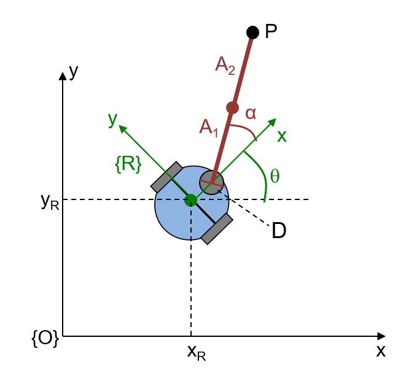
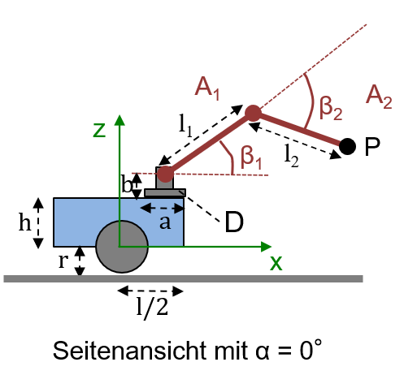
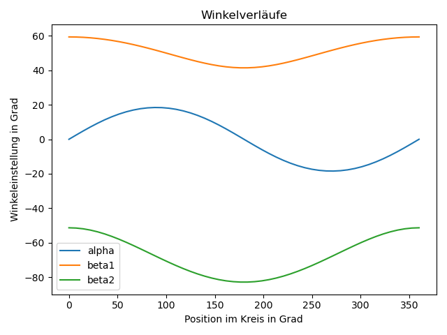

# 2. Greifarmkinematik

## 2.1 Vorwärtskinematik

| $`x_R`$ | $`y_R`$ | $`\theta`$ | $`l`$ | $`h`$ | $`r`$ | $`a`$ | $`b`$ | $`\alpha`$ | $`l_1`$ | $`\beta_1`$ | $`l_2`$ | $`\beta_2`$ |
|---------|---------|------------|-------|-------|-------|-------|-------|------------|---------|-------------|---------|-------------|
| 2       | 1       | 30°        | 0.6   | 0.2   | 0.1   | 0.1   | 0.1   | 40°        | 0.5     | 30°         | 0.5     | -10°        |

Die Tabelle legt die Parameter des mobilen Greifarmroboters aus Aufgabe 2.4 aus der Vorlesung fest.
Implementieren sie die Vorwärtskinematik für diesen Roboter in `task2.py`.
Geben Sie den Punkt $`P^O`$ der Armspitze von $`A_2`$ im globalen KS $`O`$ an.
Überprüfen sie ihr Ergebnis mit $`P^{A2} = (0,0,0,1)`$.
Der resultierende Punkt sollte sich bei $`P^O = (2.525,1.973,0.821,1.000)`$ befinden.

Der Test `test_forward_kinematics2_1` in `test_task2_1.py` überprüft das Ergebnis für $`P^{A2} = (0,0,0,1)`$ mit den in der Tabelle angegeben Werten.
In `test_task2_1.py` befinden sich noch weitere Tests für die Vorwärtskinematik, bei denen der Roboter allerdings am Punkt $`(0,0,0)`$ mit einer Ausrichtung $`\theta = 0.0`$ steht.
Die Tests zur Vorwärtskinematik können wie folgt aufgerufen werden:

```bash
python3 -m pytest --tb=short --no-header -v exercise2/exercise2_tests/test_task2_1.py
```

<p float="left" style="text-align: center">
    
    
</p>

## 2.2 Inverse Kinematik

Gegeben ist die Position $`P^R`$ der Armspitze von $`A_2`$ im Roboter-KS $`R`$.
Leiten Sie durch algebraische oder geometrische Überlegungen die inverse Kinematik her.
Berücksichtigen Sie dabei die Lösung der Aufgabe 2.5 aus der Vorlesung.
Sehen Sie Elbow-Up voraus (wie in der Zeichnung), um eine eindeutige Lösung zu erhalten.
Schreiben Sie eine Funktion, die aus $`P^R`$ die drei Gelenk-Drehwinkel $`\alpha`$, $`\beta_1`$ und $`\beta_2`$ berechnet.
Vernachlässigen Sie eventuelle Kollisionen mit dem Roboter.

Werfen Sie einen `ValueError`, wenn ein Punkt durch den Roboter nicht erreicht werden kann.

Sie können ihre Implementierung mit folgenden Tests prüfen.

```bash
python3 -m pytest --tb=short --no-header -v exercise2/exercise2_tests/test_task2_2.py
```

## 2.3 Kartesische Bewegung

Definieren Sie im Roboter-KS $`R`$ eine vertikale Tafel und schreiben Sie eine Funktion,
die mithilfe der inversen Kinematik aus Aufgabe 2.2 eine Bewegung des Greifarms so durchführt,
dass die Armspitze von Arm $`A_2`$ auf der Tafel einen Kreis beschreibt.
Implementieren Sie die Funktion `joint_angles_for_circle_motion`, um die für eine Kreisbewegung erforderlichen Gelenkwinkel des Arms zu erzeugen. Verwenden Sie zum Generieren der Gelenkwinkel  ``np.linspace`` im Bereich von $`0`$ bis $`2 \pi`$.

Sie können die Funktion `joint_angles_for_circle_motion` mit folgendem Test testen:

```bash
python3 -m pytest --tb=short --no-header -v exercise2/exercise2_tests/test_task2_3.py
```

Plotten Sie außerdem die Gelenkwinkelverläufe für $`\alpha`$, $`\beta_1`$ und $`\beta_2`$ mit Hilfe des Python-Pakets matplotlib.
Speichern Sie Ihren Plot unter `exercise2/plots/gelenkwinkel.png` ab.
Überprüfen sie Ergebnisse in dem sie einen Kreis mit einem Radius von 0.25m um den Mittelpunkt $`KM^R = (1.000,0.000,0.550,1.000)`$ im Roboterkoordinatensystem $`R`$ zeichnen.
Die Winkelverläufe sollten dann wie folgt aussehen:

<figure style="text-align: center">
    
    <figcaption>Winkelverläufe für Kreis mit Radius 0.25m <br>in
einem Abstand von 1.0m im Roboter-KS R.</figcaption>
</figure>

Überprüfen Sie Ihr Ergebnis durch Anwendung der Vorwärtskinematik. Diese sollte Ihnen die Punkte des Kreises zu den entsprechenden Gelenkwinkeln liefern.
Plotten Sie diesen Kreis und speichern Sie den Plot unter `exercise2/plots/kreis.png` ab. Die CI-Pipeline überprüft, ob ihre Plots im richtigen Ordner gespeichert sind.


## Abgabe

Bearbeiten Sie die Aufgabe mit ihrem Team in Branch `exercise2`.
Sobald Sie fertig sind, stellen Sie einen Merge Request gegen den Branch `main`.
Die Abgabe gilt als bestanden, wenn die CI-Tests ohne Fehler durchlaufen und der Merge-Request akzeptiert wurde.

