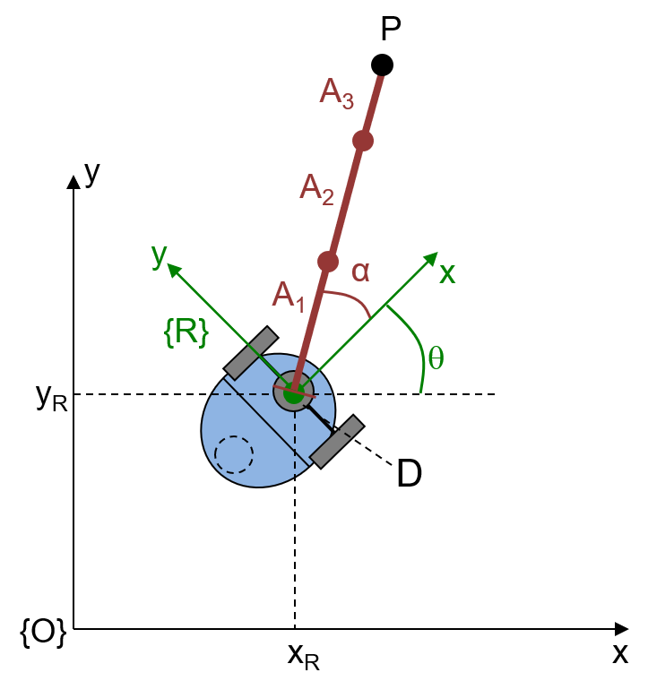
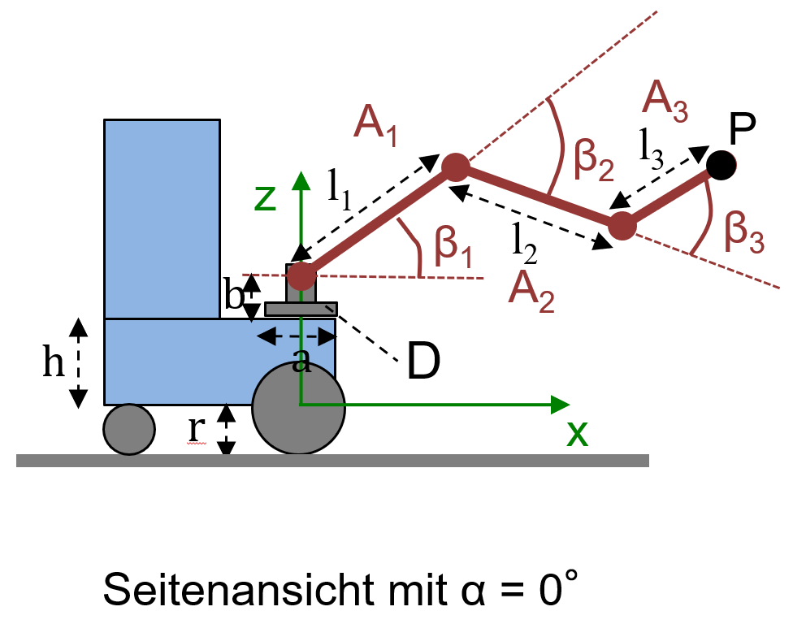

# 3. Ansteuerung eines mobilen Greifarmroboters in ROS2

In dieser Aufgabe lernen Sie das Robot Operating System 2 (ROS2) kennen.
Sie werden Ihre ersten Programme (Nodes) dafür schreiben um den Umgang mit ROS2 und dessen Arbeitsweise kennenzulernen.
Zur Strukturierung von verschiedenen Projekten werden in ROS2 Packages verwendet.

## 3.1 ROS2 Packages und Nodes

Erstellen Sie im Ordner `exercise3` ihr erstes ROS2 Python Package `py_pubsub` welches einen Publisher Node `talker` und einen Subscriber Node `listener` enthalten soll.

* Der Publisher-Node soll jede Sekunden eine String-Message `„Hello this is my first ROS Node and it runs since 1 seconds.“` auf dem Topic `/chatter` publizieren. 
  Dabei sollen die Sekunden immer weiter hochgezählt werden.

* Der Subscriber-Node soll diese Nachricht auf dem `/chatter` Topic empfangen und über den ROS-Logger auf dem Level `info` ausgeben.

Orientieren Sie sich bei Ihrer Implementierung am **ROS2 Tutorial:**

* https://docs.ros.org/en/humble/Tutorials/Beginner-Client-Libraries/Writing-A-Simple-Py-Publisher-And-Subscriber.html

**Hinweis:** Verwenden Sie beim Bauen Ihres Package den Zusatz `--symlink-install`. Dann können Sie in Ihrem Python Code Änderungen vornehmen, ohne dass Sie das Package neu bauen müssen.

**Hinweis:** Rufen Sie den build-Befehl immer in ihrem ROS2 Workspace auf (z.B. ~/ros2_ws/) und bedenken Sie, dass Sie nach dem Bauen Ihren Workspace noch sourcen müssen bevor Sie die Nodes starten können.

```bash
cd ~/ros2_ws
colcon build --symlink-install
source install/setup.bash
```

Sie können Ihren `talker`-Node auch über einen Test testen.

```bash
colcon test --event-handlers console_direct+ --packages-select exercise3_tests --pytest-args --no-header -q -v -k 'test_talker'
```

Beachten Sie, dass neben der Funktionalität standardmäßig auch eine korrekte Formatierung, ungenutzte Imports, etc. geprüft werden.
Um Ihnen das Formatieren ein wenig zu erleichtern, empfiehlt sich die Extension ``autopep8`` von Microsoft als Formatter in VS-Code zu verwenden.
Sie können die korrekte Formatierung für Ihr `py_pubsub`-Package folgendermaßen testen:

```bash
colcon test --event-handlers console_direct+ --packages-select py_pubsub --pytest-args --no-header -v
```

## 3.2 ROS2 Ansteuerung eines Gelenkarms

Erstellen Sie ein neues Package `my_jk_rollin_kinematics` zur Ansteuerung des Gelenkarms des Roboters JK_Rollin.
Erweitern Sie hierfür ihr kinematisches Modell aus Exercise 2 um einen dritten Arm $`A_3`$ wie in Übung 2.5. 
Es müssen also die Gelenkwinkel für `turntable` ($`\alpha`$), `shoulder` ($`\beta_1`$), `elbow` ($`\beta_2`$) und `wrist` ($`\beta_3`$) berechnet werden.

Die Abmessungen des Roboters und seine Konfiguration haben sich geändert. 
Beachten Sie, die geänderten Werte in der Tabelle und den Grafiken und dass der Drehteller nun in der z-Achse des Roboter-KS liegt. 

| $`x_R`$ | $`y_R`$ | $`\theta`$ | $`l`$ | $`h`$ | $`r`$ | $`a`$ | $`b`$ | $`\alpha`$ | $`l_1`$ | $`\beta_1`$ | $`l_2`$ | $`\beta_2`$ | $`l_3`$ | $`\beta_3`$ |
|---------|---------|------------|-------|-------|-------|-------|-------|------------|---------|-------------|---------|-------------|---------|-------------|
| 2       | 1       | 30°        | 0.0   | 0.021 | 0.026 | 0.12  | 0.047 | 40°        | 0.093   | 40°        | 0.082   | -60°        | 0.051   | 50°         |

<p float="left" style="text-align: center">
    
    
</p>

## 3.2.1 JK_Rollin Package

Der Roboter selbst ist im Package `jk_rollin` definiert. Klonen Sie sich dieses Repository in Ihren Workspace in den `src` Ordner.

```bash
cd ~/ros2_ws/src
git clone -b humble https://github.com/Robotics-HTWG/jk-rollin
```

Bevor Sie den Roboter verwenden können, müssen Sie das Package erst bauen.

```bash
cd ~/ros2_ws
colcon build --symlink-install
source install/setup.bash
```

Verwenden Sie RViz zum Anzeigen des Roboters.

```bash
ros2 launch jk_rollin_description display.launch.py
```

Der Arm des Roboters wird jetzt allerdings noch nicht korrekt angezeigt, da die Gelenkwinkel noch nicht bekannt sind.
Sie können mit dem Argument ```gui:=true``` allerdings ein kleines Hilfsprogramm (```joint_state_publisher_gui_node```) starten über welches Sie die Winkel der Gelenke einstellen können.
Dieses sollten Sie aber nicht starten, wenn Sie Ihre eigenen Nodes verwenden, da sonst Ihre Gelenkwinkel von denen der ```joint_state_publisher_gui``` überschrieben werden.

```bash
ros2 launch jk_rollin_description display.launch.py gui:=true
```

<details>
<summary><b>Hinweise zur Verwendung des eigenen Rechners:</b>
Klicken Sie <b>hier</b> um weitere Informationen zu erhalten.</summary>

Um das Roboter-Modell in RViz anzeigen und bewegen zu können benötigen Sie die folgenden ROS-Packages:

```bash
sudo apt install ros-humble-xacro ros-humble-joint-state-publisher-gui
```

</details>

## 3.2.2 Implementierung der Inversen Kinematic

Implementieren Sie in Ihrem `my_jk_rollin_kinematics`-Package einen Node `jk_rollin_arm_ik` welcher die Inverse Kinematik des Arms implementiert. 
Dieser Node empfängt auf dem Topic `/tool_pose` eine `geometry_msgs/PoseStamped`-Message mit den kartesischen Koordinaten der Zielpose der Armspitze. 
Berechnen Sie daraus die erforderlichen Gelenkwinkel und publizieren Sie eine `sensor_msgs/JointState`-Message auf das Topic `/joint_states`. 
In der JointState-Message müssen Sie die Winkel in das `position`-array in der Reihenfolge entsprechend der Namen der Gelenke im `name`-array, eintragen. 
Gehen Sie bei Ihrer Implementierung davon aus, dass die Koordinaten des Zielpunkts der Armspitze im Roboter-Koordinatensystem gegeben sind. 
Sehen Sie weiterhin Elbow-Up vor.
Überprüfen Sie auch ob die Pose der Armspitze erreicht werden kann.
Wenn nicht, werfen Sie einen `ValueError` und senden dann **keine** `JointState` Message, sondern geben eine Warnung mit `self.get_logger().warning(...)` aus.

Bevor Sie ihren Node starten können, müssen sie diesen zuerst einmal bauen und den Workspace sourcen.

```bash
cd ~/ros2_ws
colcon build --symlink-install
source install/setup.bash
```

Überprüfen Sie ihre Implementierung in dem Sie in einem Terminal Ihre inverse Kinematik starten.
In einem zweiten Terminal starten Sie RVIz für die Visualisierung und in einem dritten Terminal senden Sie eine Zielpose an Ihre inverse Kinematik.

Im ersten Terminal starten Sie ihre Node für die inverse Kinematik:

```bash
ros2 run my_jk_rollin_kinematics jk_rollin_arm_ik
```

Im zweiten Terminal die Visualisierung mit RViz:

```bash
ros2 launch jk_rollin_description display.launch.py
```

Im dritten Terminal senden Sie eine `PoseStamped`-Message auf das `/tool_pose`-Topic:

```bash
ros2 topic pub /tool_pose geometry_msgs/msg/PoseStamped "{header: {frame_id: 'base_frame'}, pose: {position: {x: 0.225, y: 0.0, z: 0.068}, orientation: {x: 0.0, y: 0.0, z: 0.0, w: 1.0}}}"
```

Sie können Ihre Implementierung der inversen Kinematik mit folgendem Test testen. 
Bedenken Sie dabei, dass Sie beim erstem Mal Ihr Package auch bauen und den Workspace sourcen müssen:

Testen mit colcon test:

```bash
cd ~/ros2_ws
colcon test --event-handlers console_direct+ --packages-select exercise3_tests --pytest-args --no-header --show-capture=no -q -v -k 'test_jk_rollin_arm_ik'
```

Alternativ können Sie die Tests auch aus dem root-Verzeichnis Ihres Repositories mit pytest aufrufen:

```bash
python3 -m pytest -v --tb=short --no-header --show-capture=no exercise3/exercise3_tests/exercise3_tests/test_jk_rollin_arm_ik.py
```


<details>
<summary><b>Hinweise zur Implementierung:</b>
Klicken Sie <b>hier</b> um weitere Informationen zu erhalten.</summary>

Den Aufbau der `geometry_msgs/PoseStamped`-Message und der `sensor_msgs/JointState`-Message finden Sie unter:

* https://docs.ros2.org/galactic/api/geometry_msgs/msg/PoseStamped.html 
* https://docs.ros2.org/galactic/api/sensor_msgs/msg/JointState.html 

Nachfolgend ein Beispiel wie die `sensor_msgs/JointState`-Message für den Arm des JK_Rollin aufgebaut ist. 
Die Winkel `alpha`, `beta_1`, `beta_2` und `beta_3` sind dabei Variablen, die Sie zuvor noch berechnen müssen.

```python
from sensor_msgs.msg import JointState

msg = JointState()
msg.header.stamp = self.get_clock().now().to_msg()  # Set timestamp for message

msg.name.append('wheel_left_joint')
msg.name.append('wheel_right_joint')
msg.name.append('turntable')
msg.name.append('shoulder')
msg.name.append('elbow')
msg.name.append('wrist')

msg.position.append(0)        # Don't turn the wheels
msg.position.append(0)        # Don't turn the wheels
msg.position.append(alpha)    # Angle of turntable
msg.position.append(beta_1)   # Arm angle beta_1 for shoulder
msg.position.append(beta_2)   # Arm angle beta_2 for elbow
msg.position.append(beta_3)   # Arm angle beta_3 for wrist
```

**Umrechnung von Euler-Winkeln und Quaternionen in ROS2**
ROS2 Transformation Library

* https://index.ros.org/p/tf_transformations/#humble-overview

Documentation to euler axis e.g. axis='ryxz'

* https://matthew-brett.github.io/transforms3d/reference/transforms3d.euler.html?highlight=euler%20py
* https://en.wikipedia.org/wiki/Euler_angles

Documentation to quaternion_from_euler in ROS2 Python:

* https://github.com/DLu/tf_transformations/blob/main/test/test_transformations.py

```python
from geometry_msgs.msg import PoseStamped
from tf_transformations import euler_from_quaternion, quaternion_from_euler

msg = PoseStamped()
msg.header.stamp = self.node.get_clock().now().to_msg()

msg.pose.position.x = 0.22599999999
msg.pose.position.y = 0.0
msg.pose.position.z = 0.068

q = quaternion_from_euler(0, 0, 0, axes='rxyz')

msg.pose.orientation.x = q[0]
msg.pose.orientation.y = q[1]
msg.pose.orientation.z = q[2]
msg.pose.orientation.w = q[3]
```

</details>

<details>
<summary><b>Hinweise zur Verwendung des eigenen Rechners:</b>
Klicken Sie <b>hier</b> um weitere Informationen zu erhalten.</summary>

Um `euler_from_quaternion` und  `quaternion_from_euler` aus dem `tf_transformations`-Package verwenden zu können, müssen Sie die Python3-transforms3d-Bibliothek installieren und das ROS2-Package-`tf_transformations`.

```bash
pip install transforms3d
sudo apt install ros-humble-tf-transformations
```

Um die Warnungen der Python-Setup-Tools zu unterdrücken, können Sie folgenden Zeile Ihrer `.bashrc` hinzufügen:

```bash
echo "export PYTHONWARNINGS=ignore:::setuptools.command.install,ignore:::setuptools.command.easy_install,ignore:::pkg_resources" >> ~/.bashrc
```

</details>

## 3.2.3 Implementierung einer Kreisbewegung

Zum Testen Ihrer Inversen Kinematik implementieren Sie einen zweiten Node `jk_rollin_draw_circle`. 
In diesem berechnen Sie Koordinaten für die Kreisbewegung und senden diese über das `/tool_pose`-Topic an Ihre Inverse Kinematik. 
Verwenden Sie dabei einen Kreis mit einem Radius von 0,04 m um den Mittelpunkt $`KM^R = (0.180,0.000,0.140,1.000)`$ im Roboterkoordinatensystem $`R`$. 
Der Arm $`A_3`$ soll dabei waagerecht nach vorne gestreckt sein. 
Verwenden Sie für den Kreis 100 Punkte und senden Sie mit einer Frequenz von 10 Hz jeweils einen Punkt.

Nachdem Sie Ihren Node gebaut und den Workspace gesourcet haben, können Sie Ihren Node starten um zu sehen ob der Roboter auch die Bewegung durchführt.
Starten Sie hierzu in einem ersten Terminal RViz um den Roboter anzuzeigen.

```bash
ros2 launch jk_rollin_description display.launch.py
```

In einem zweiten Terminal starten Sie dann Ihre inverse Kinematik für den Roboter.

```bash
ros2 run my_jk_rollin_kinematics jk_rollin_arm_ik
```

Und in einem dritten Terminal dann Ihren `jk_rollin_draw_circle`-Node.

```bash
ros2 run my_jk_rollin_kinematics jk_rollin_draw_circle
```

Ihren `jk_rollin_draw_circle`-Node können Sie auch wieder mit den entsprechenden Tests testen.

```bash
cd ~/ros2_ws
colcon test --event-handlers console_direct+ --packages-select exercise3_tests --pytest-args --no-header --show-capture=no -q -v -k 'test_jk_rollin_draw_circle'
```

Alternativ können Sie die Tests auch aus dem root-Verzeichnis Ihres Repositories mit pytest aufrufen:

```bash
python3 -m pytest -v --tb=short --no-header --show-capture=no exercise3/exercise3_tests/exercise3_tests/test_jk_rollin_draw_circle.py
```

## Abgabe

Bearbeiten Sie die Aufgabe mit ihrem Team in Branch `exercise3`.
Sobald Sie fertig sind, stellen Sie einen Merge Request gegen den Branch `main`.
Die Abgabe gilt als bestanden, wenn die CI-Tests ohne Fehler durchlaufen und der Merge-Request akzeptiert wurde.
